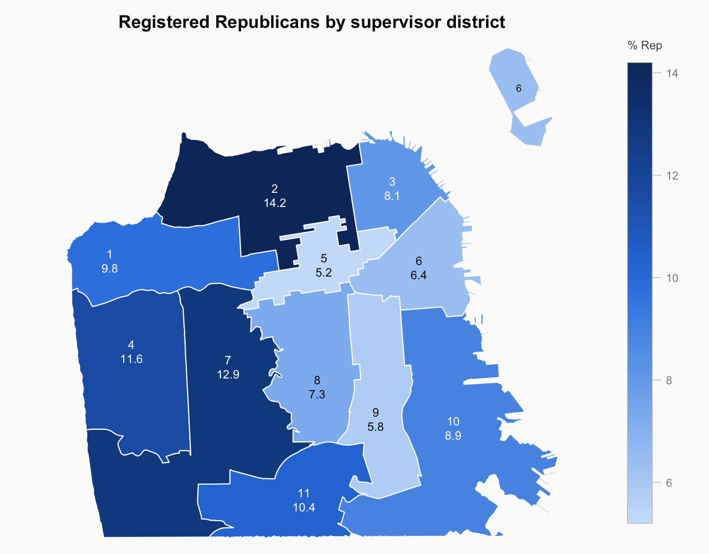

# Briones

Map numeric data onto the eleven San Francisco Board of Supervisors districts.

Hand it a data frame with one row per district and a numeric column; it draws
the city with each district shaded on a colour gradient, plus a scale legend.
The gradient is specified exactly the way `image()` and `heatmap()` take one — a
vector of colours, optionally with `zlim` or `breaks`.

District boundaries ship inside the package, so nothing is downloaded at run
time. **There are no dependencies**: base graphics only, no `sf`, no GDAL,
nothing to compile.

## Install

```r
R CMD INSTALL .
# or, from R, in the parent directory:
install.packages("Briones", repos = NULL, type = "source")
```

## Use

```r
library(Briones)

reg <- data.frame(district = 1:11,
                  pct.rep  = c(9.8, 14.2, 8.1, 11.6, 5.2, 6.4,
                               12.9, 7.3, 5.8, 8.9, 10.4))

SfDistrictMap(reg, main = "Registered Republicans by supervisor district")
```



That is the whole API for the common case. `SfDistrictMap()` finds the
district column by name and takes the first numeric column as the value, so
`district`/`value` only need naming when the guess would be wrong:

```r
SfDistrictMap(reg, district = "district", value = "pct.rep")
```

District identifiers can be numbers or strings — `1`, `1.0`, `"01"`,
`"District 1"` all match. Rows may be in any order. Districts you leave out, or
give an `NA`, are drawn in `na.col` and get a "no data" swatch in the legend.

### Gradients

`col` is any vector of colours, low end first, so base R palettes work:

```r
SfDistrictMap(reg, col = hcl.colors(64, "YlOrRd", rev = TRUE))
SfDistrictMap(reg, col = heat.colors(64))
SfDistrictMap(reg, col = gray.colors(64, start = 0.95, end = 0.1))
```

`SfPalette()` supplies two gradients built for the job:

```r
SfPalette("blue", 64)       # sequential: one hue, light to dark
SfPalette("blue-red", 64)   # diverging: two hues, neutral grey midpoint
```

Use a **sequential** gradient for a magnitude ("how much"), and a **diverging**
one only for a value read against a baseline, paired with `center` so the
neutral midpoint lands on the value that means "no difference":

```r
SfDistrictMap(reg, col = SfPalette("blue-red", 64), center = 9.1,
              na.col = "#c3c2b7", legend.title = "% Rep")
```

A multi-hue "rainbow" gradient is not offered on purpose: it invents
boundaries the data does not have.

### Controlling the scale

```r
## Fixed range, so several maps are comparable
SfDistrictMap(reg, zlim = c(0, 20))

## Unequal classes, e.g. quintiles
SfDistrictMap(reg, breaks = quantile(reg$pct.rep, seq(0, 1, length.out = 6)),
              col = SfPalette("blue", 5))
```

Values outside `zlim` take the colour at that end of the gradient. Pass
`clip = FALSE` for `image()`'s behaviour of treating them as missing instead.

### Labels

```r
SfDistrictMap(reg, labels = c("district", "value"))
SfDistrictMap(labels = c("district", "supervisor"), legend = FALSE,
              label.cex = 0.62)
```

`labels` takes any of `"district"`, `"supervisor"` and `"value"`, stacked in
the order given. `label.col = "auto"` (the default) picks black or white per
district for contrast against the fill.

District 6 is drawn in two pieces — the mainland and Treasure Island — so it
gets a bare `6` on the island as well, which is the only thing on the map that
says which district the island belongs to. Turn that off with
`label.parts = FALSE`. It applies only when `labels` includes `"district"`,
since a lone `6` beside mainland labels reading `6.4` would read as a value.

### Two maps, one scale

Give both the same `zlim`, turn off the per-panel legends, and draw one legend:

```r
reg$pct.dem <- c(58, 49, 61, 52, 71, 68, 50, 66, 70, 63, 57)
op <- par(mfrow = c(1, 2))
SfDistrictMap(reg, value = "pct.rep", zlim = c(0, 75), main = "Republican")
SfDistrictMap(reg, value = "pct.dem", zlim = c(0, 75), main = "Democrat")
par(op)
```

### The return value, and the raw data

`SfDistrictMap()` returns (invisibly) what it drew — handy for a legend or a
table that has to match:

```r
drawn <- SfDistrictMap(reg)
head(drawn)                 # district, supervisor, value, col
attr(drawn, "breaks")
```

The boundaries themselves are plain data frames: `sf.districts` (one row per
polygon vertex), `sf.district.info` (one row per district — supervisor, area,
label point) and `sf.district.labels` (one row per labelled map part, which is
where the Treasure Island label point lives). `SfDistrictPolygons()` returns
the vertices with your values merged on, which is what you want to draw the
map with something else:

```r
library(ggplot2)
ggplot(SfDistrictPolygons(reg), aes(long, lat, group = part, fill = pct.rep)) +
  geom_polygon(colour = "white") +
  coord_map() +
  scale_fill_gradientn(colours = SfPalette("blue", 64))
```

## Notes on the map itself

- **Projection.** None. Longitude and latitude are plotted directly with the
  aspect ratio corrected for San Francisco's latitude, which is what keeps the
  shapes from looking stretched. Over a city-sized area the difference from a
  projected map is not visible.
- **Default view.** Frames the city. Two Bay water slivers under 0.2 km² are
  outside it — they would stretch the window by about a third for a few pixels
  of ink — and are drawn if you widen `xlim`/`ylim`.
- **The Farallon Islands** legally belong to District 4 but sit 40 km offshore,
  so they are excluded unless you ask for `offshore = TRUE`. Try it once to see
  why it is not the default.
- **Treasure Island** is part of District 6, is shown, and is labelled `6` so
  that is apparent.

## Data source and refreshing it

Boundaries come from DataSF, *Current Supervisor Districts* (dataset
`f2zs-jevy`, <https://data.sf.gov/>), retrieved 13 September 2026 and current
as of 8 January 2025. They are the lines adopted in the 2022 redistricting. The
geometry is not simplified.

Supervisor names are a snapshot and change with each election. To refresh
everything:

```sh
curl -L "https://data.sfgov.org/api/geospatial/f2zs-jevy?method=export&format=GeoJSON" \
  -o data-raw/sf-supervisor-districts.geojson
python3 data-raw/01-geojson-to-csv.py   # GeoJSON -> flat CSVs
Rscript data-raw/02-build-rda.R         # CSVs -> data/*.rda
R CMD INSTALL .
```

Python is used only for that one-off conversion, so that the installed package
needs no JSON parser. Keep the CSVs — they are the reviewable intermediate.

## Tests

```sh
Rscript tests/test-Briones.R      # or: R CMD check Briones_0.1.0.tar.gz
```
